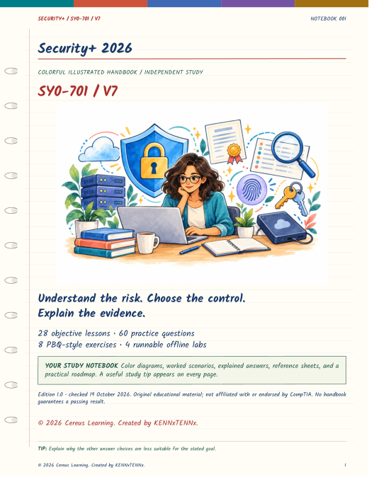

# Cereus Learning Prep

### Learn IT. Practice with purpose. Build proof of your skills.

Illustrated study resources for people learning information technology, preparing for certifications, and building confidence through hands-on practice.

Created by **KENNxTENNx** · **Cereus Learning**

## Start here: Security+

**[Download the Security+ 2026 handbook](handbooks/securityplus/CompTIA_SecurityPlus_2026_Color_Handbook.pdf?raw=true)** · [Preview the PDF](handbooks/securityplus/CompTIA_SecurityPlus_2026_Color_Handbook.pdf)

  

| Inside the handbook | What you can do with it |
| --- | --- |
| 126 colorful pages | Study illustrated explanations, diagrams and comparison tables |
| 28 lessons | Work through all 28 top-level SY0-701 objectives |
| 60 practice questions | Check answers and understand the reasoning |
| Eight PBQ-style exercises | Practice decisions with worked solutions and scoring rubrics |
| Four offline Python labs | Explore log triage, backup restoration, hash integrity and allowlist decisions |
| Tips on every page | Build recall and better troubleshooting habits |
| Final-page roadmap | Practice interviews and choose portfolio projects |

**Exam target: SY0-701 / V7.** Confirm the exam code on your booking and use the matching [official CompTIA Security+ objectives](https://www.comptia.org/en-us/certifications/security/). This edition includes version-transition guidance. The official detailed objectives are your final coverage checklist.

## A practical way to study

1. Read one lesson and draw its main idea from memory.
2. Explain the scenario before checking the worked reasoning.
3. Complete a retrieval drill, tabletop exercise or local lab.
4. Record your result, the evidence and what the exercise cannot prove.
5. Review mistakes after 1, 3, 7 and 14 days.

Use the **[eight-week study plan](docs/STUDY_PLAN.md)** and copy the **[study tracker](templates/STUDY_TRACKER.md)** into your own notes.

## Who this is for

- Students starting an IT, networking or cybersecurity program.
- Career changers building technical foundations.
- Certification learners who benefit from colorful visual explanations.
- Self-directed learners turning a home lab into a documented portfolio.

## Learning paths

Security+ is the first published resource in this repository. These paths give the collection its direction; they are not claims that additional handbooks are already available here.

| Path | Build these foundations | Show your progress |
| --- | --- | --- |
| IT fundamentals | Hardware, operating systems, troubleshooting and documentation | Write a reproducible support case |
| Networking | Addressing, switching, routing and traffic flow | Diagram and test a small isolated network |
| Cybersecurity | Identity, controls, risk, investigation and recovery | Explain a security decision with evidence |
| Linux and Python | Command-line work, files, scripting and automation | Build and explain a small repeatable tool |
| Cloud and containers | Shared responsibility, identity, deployment and observability | Document a small lab with cost and cleanup checks |

## Practice responsibly

Use synthetic data and systems you own or are authorized to test. The handbook's offline examples demonstrate specific concepts; their results do not establish production security or full exam readiness. Practice questions and PBQ-style exercises are original educational material, not actual exam items.

## Improve the collection

Found an unclear explanation, broken link or technical error? Open an issue using the study-material correction template. Include the page, objective, proposed correction and a primary source when possible. Read [Contributing](CONTRIBUTING.md) before sending changes.

## About

Cereus Learning Prep helps IT learners connect concepts, practice and evidence. This is an independent educational project and is not affiliated with or endorsed by CompTIA. Certification names belong to their respective owners.

© 2026 Cereus Learning. Created by KENNxTENNx.
